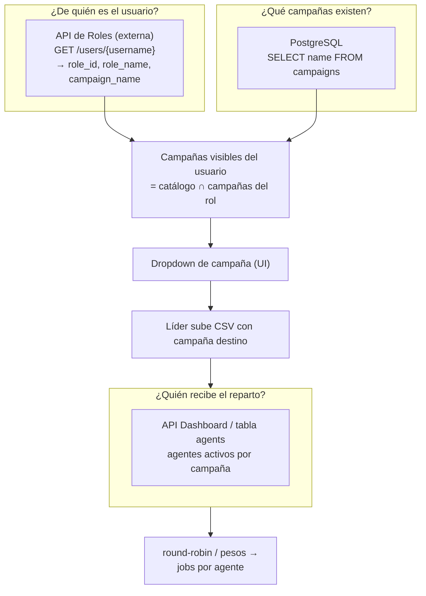
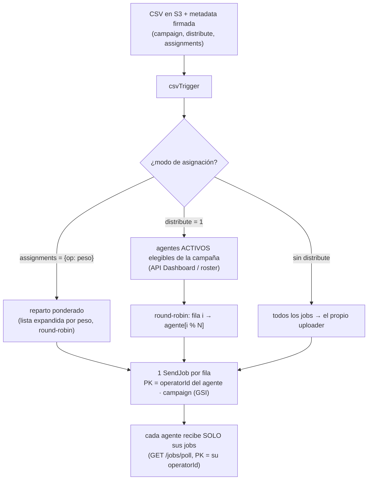

# Campañas y asignación de contactos — guía reutilizable

Cómo se obtienen las campañas de un usuario y cómo, cuando un líder sube contactos, se decide **a qué agentes se asignan**. Pensado como patrón portable a otros proyectos del ecosistema (Pernexium), no solo ana.

---

## 0. Resumen del patrón

Hay **tres fuentes distintas** y cada una responde una pregunta diferente. No las confundas:

| Fuente | Pregunta que responde | Dónde |
|---|---|---|
| **API de Roles** (externa) | ¿A qué campañas pertenece este usuario? (identidad) | `GET /users/{username}` |
| **Tabla `campaigns`** (PostgreSQL) | ¿Qué campañas existen en el sistema? (catálogo) | `SELECT name FROM campaigns` |
| **API del Dashboard / roster** | ¿Qué agentes activos hay para repartir en una campaña? | `GET /users/campaign/{campaign}` + heartbeat |

La **lista que ve un usuario** = catálogo (PostgreSQL) ∩ sus campañas (API de Roles).
El **reparto** = filas del CSV repartidas entre los **agentes activos** de la campaña destino.



---

## 1. Campañas del usuario (identidad)

La **fuente de verdad de identidad** es la API externa de Roles. Un usuario tiene N roles; cada rol trae su `campaign_name`. Las campañas del usuario son el conjunto de `campaign_name` de sus roles.

```
GET {ROLES_API_BASE}/users/{username}
Header: X-Api-Key: {ROLES_API_KEY}

→ { "roles": [
      { "role_id": "...", "role_name": "Líder DIDI VIP", "campaign_name": "didi_vip",
        "permissions": [ { "permission_name": "ana:..." } ] },
      ...
] }
```

- `username` = el claim `cognito:username` del JWT (en ana es el `operatorId`).
- **Gotcha**: los permisos vienen *inline* como `permission_name`, NO en un endpoint aparte. No llames `/roles/{id}/permissions`.
- Caso `campaign_name = "*"` o rol admin → ve **todas** las campañas (global).
- Si la API falla, devuelve `[]` pero **no caches el vacío** como "sin campañas": un outage no debe convertirse en denegación. (Ver `resolveUserAccess` en ana.)

Implementación de referencia: `backend/src/lib/roles.ts` (`getUserRoles`), `backend/src/lib/access.ts` (`resolveUserAccess` → arma `campaigns: string[]`).

---

## 2. Catálogo de campañas (qué existe)

Las campañas que existen en el sistema viven en **PostgreSQL**:

```sql
SELECT name FROM campaigns;
```

- Conexión por `DATABASE_URL` o campos sueltos `PGHOST/PGPORT/PGUSER/PGPASSWORD/PGDATABASE` (estilo pgAdmin). TLS cifrado.
- **Cachear**: las campañas cambian poco y se consultan seguido. En ana se cachea 10 min en memoria del Lambda caliente; si la DB cae se sirve lo último (stale > vacío). Ver `backend/src/lib/campaignsDb.ts`.

Implementación: `backend/src/lib/db.ts` (pool) + `campaignsDb.ts` (`listCampaignsDb`, `campaignExists`).

---

## 3. Lo que el usuario ve (catálogo ∩ identidad)

El endpoint que alimenta el dropdown cruza ambas fuentes:

```
GET /agents/campaigns   (con JWT)
```

Lógica (`backend/src/handlers/agents.ts` → `campaignsList`):

```
all = listCampaignsDb()                    // catálogo PostgreSQL
if (isAdmin || campaigns incluye "*")  → devuelve all
else                                   → all.filter(c => campañas-del-rol.has(c))
```

- **Admin / global**: ve todo el catálogo.
- **Líder / agente**: solo las campañas de sus roles que además existen en el catálogo.

En el front, un dropdown **buscable y solo-elegir** (no acepta texto libre) consume esta lista → así nunca se manda una campaña inexistente. Ver `desktop/src/ui/SearchableSelect.tsx` y `desktop/src/routes/Campaigns.tsx`.

---

## 4. Subida del líder y asignación (a dónde van los contactos)

El líder elige una **campaña destino** (paso 3) y sube el CSV. La campaña viaja **firmada** en la metadata del objeto S3 (presigned PUT) — el cliente no puede alterarla después.

```
POST /uploads/presign  { campaign, distribute, assignments?, template, phoneColumn }
  → valida: el usuario puede subir (líder/admin), la campaña es suya y EXISTE
  → presigned URL con metadata firmada (operatorId, campaign, distribute, …)
PUT  {presigned}  → S3 csv-uploads/{usuario}/{ts}_{archivo}.csv
```

El evento `ObjectCreated` dispara el trigger, que decide los **destinatarios** de los jobs:



### Quién es "agente activo elegible"

Para `distribute=1` el trigger pide el roster de la campaña (en ana, API del Dashboard `imery`):

```
GET {DASHBOARD_BASE_PATH}/users/campaign/{campaign}
Header: X-Api-Key: {DASHBOARD_API_KEY}
→ usuarios; se filtran:
   · active === true
   · email externo (no interno @pernexium / @dirsa)
   · si la campaña exige rol (env AGENT_ROLE_<CAMPAÑA>), debe traerlo
```

Alternativa interna (sin Dashboard): la tabla `agents` con **heartbeat**. Cada desktop hace `POST /agents/heartbeat` al conectar WhatsApp y cada 5 min; "activo" = `lastSeen` < 10 min. Ver `backend/src/lib/agents.ts`.

### El reparto en sí

- **round-robin**: `targets[i % targets.length]` por fila. Reparto parejo.
- **ponderado** (`assignments = {operatorId: peso}`): se expande la lista (`{a:2,b:1}` → `[a,a,b]`) y se aplica el mismo round-robin → respeta proporciones.
- **sin distribute**: el uploader se queda todos (revisa/envía él mismo).

Cada job se escribe con `PK = operatorId` del agente destino → el aislamiento es natural: en `GET /jobs/poll` cada agente consulta solo su partición. Un GSI por campaña (`campaign-status-index`, que proyecta `status`; nombre en `JOBS_CAMPAIGN_INDEX`) permite al líder ver los pendientes reales por campaña y **reasignar** pendientes de un agente caído a otro (`POST /jobs/reassign`, por lotes en paralelo con presupuesto de 25 s y `partial: true` si falta). No hay reserva por poll: un job es pendiente (`pending`, sin estado o el estado heredado `leased`) o ya procesado. El `jobId` es `<identificador de carga>#<índice>` con el identificador generado por el servidor (la key del CSV sin `csv-uploads/`); el `campaignId` del cliente se guarda como `label`.

Implementación: `backend/src/handlers/csvTrigger.ts`, `backend/src/lib/dashboard.ts`, `backend/src/handlers/jobsAdmin.ts`.

---

## 5. Checklist para portar a otro proyecto

1. **Identidad**: cliente de la API de Roles (`X-Api-Key`), `getUserRoles(username)` → extrae `campaign_name` de cada rol. No caches el vacío.
2. **Catálogo**: conexión a la DB de campañas, `SELECT name FROM campaigns`, con caché corta.
3. **Cruce**: endpoint que devuelve `catálogo ∩ roles` (admin = todo). Aliméntalo a un dropdown buscable que no acepte texto libre.
4. **Validación server-side**: al recibir una campaña (subida o acción), verifica que el usuario la tenga y que exista en el catálogo. Nunca confíes en el cliente.
5. **Reparto**: define "agente activo" (roster externo o heartbeat propio) y aplica round-robin o pesos. Escribe el trabajo particionado por destinatario para aislar el consumo.
6. **Reasignación**: indexa el trabajo por campaña (GSI) para poder mover pendientes si un agente cae.

## 6. Variables de entorno relevantes (backend)

| Variable | Para qué |
|---|---|
| `ROLES_API_BASE` / `ROLES_API_KEY` | API de identidad/roles del usuario |
| `DASHBOARD_BASE_PATH` / `DASHBOARD_API_KEY` | roster de agentes activos por campaña |
| `AGENT_ROLE_<CAMPAÑA>` | (opcional) rol requerido para ser elegible en esa campaña |
| `PGHOST/PGPORT/PGUSER/PGPASSWORD/PGDATABASE` o `DATABASE_URL` | catálogo de campañas (PostgreSQL) |

> Todas son secretos de **backend** (`backend/.env`), nunca del cliente. El desktop solo manda el JWT; el backend resuelve identidad, catálogo y roster.

## 7. Interacciones en el CRM (fecha, hora e idempotencia)

- **Zona horaria**: `contact_date`, `contact_time` y `range_time` se calculan en `America/Mexico_City` (`mxDateParts` en `backend/src/lib/interactions.ts`), sin depender de la zona de la Lambda (UTC). Ejemplo: un envío a las 01:30 UTC del 2026-11-06 se registra como `contact_date: "2026-11-05"`, `contact_time: "19:30"`, `range_time: "19:00 - 20:00"`; en la última hora del día `range_time` es `"23:00 - 00:00"`. El día del marcador de apertura de chat también es el día de México.
- **Idempotencia con estados** (`backend/src/lib/idempotency.ts`): los marcadores `REPORT#<usuario>/<jobId>` (7 días), `OPEN#<usuario>/<chatId>#<YYYY-MM-DD>` (2 días) y `MANUAL#<usuario>/<requestId>` (2 días) en la tabla de jobs se reservan como `pending`, pasan a `done` solo si el CRM insertó y se borran si falló (respuesta `retryable: true`). Una reserva `pending` de más de 2 minutos se considera abandonada. Respuestas: `"ya reportado"` / `"ya registrado hoy"` (ya `done`) y `"en curso"` (otra invocación lo está procesando). Los marcadores anteriores sin `status` cuentan como `done`.
- **Reintento del desktop**: ante `retryable: true`, 5xx o red caída, el desktop reintenta el reporte del job a los 30 s, 2 min y 10 min, sin frenar el envío (solo en memoria).
- **Gestión manual**: el desktop manda un `requestId` (UUID) por apertura del modal "Registrar gestión"; el mismo `requestId` registra una sola interacción.
- **Interacciones anteriores al despliegue** (fecha/hora UTC): las de v4 con `contact_time` entre `00:00` y `05:59` registradas antes del despliegue corresponden a las 18:00–23:59 del **día anterior** en Ciudad de México (y en general toda hora previa está 6 h adelantada). No se corrigen automáticamente.

## 8. Formatos de teléfono aceptados (lada 52)

Reglas únicas en desktop (`desktop/electron/whatsapp/phone.ts`) y backend (`backend/src/lib/phone.ts`), probadas con los vectores compartidos `v4/shared/phone-mx-vectors.json`. Se decide por **longitud**, no por prefijo de texto; espacios, guiones y paréntesis se ignoran:

| Escrito en el CSV | Se consulta como |
|---|---|
| `5512345678` / `55 1234 5678` (10 dígitos) | `525512345678` |
| `525512345678` / `+52 55 1234 5678` / `0052 55 1234 5678` | `525512345678` |
| `5215512345678` / `+52 1 55 1234 5678` | `525512345678` |
| `044 55 1234 5678` / `045 55 1234 5678` | `525512345678` |
| `01 55 1234 5678` | `525512345678` |
| `1 55 1234 5678` | `525512345678` |
| `+1 305 555 1234` / `001 305 555 1234` (extranjero: **siempre con `+` o `00`**) | `13055551234` |
| `12345`, `05512345678`, vacío… | inválido |

- Un teléfono **inválido** deja el job en `error` con "Teléfono inválido": no se consulta WhatsApp, se reporta al CRM como `error` (no contactable) y **no** se marca el teléfono sin WhatsApp.
- Un número extranjero escrito sin `+`/`00` (p. ej. `13055551234`) se interpreta como `1` + 10 dígitos de México.
- La búsqueda del `credit_id` en el CRM usa `+` + el número normalizado (`0445512345678` → `+525512345678`, reintentando sin `+52` ante 404).

**Teléfonos marcados sin WhatsApp por error antes de este cambio**: revisar en el historial de jobs (TTL 7 días, tabla `ana-backend-jobs-<stage>`) los jobs con `status = no_whatsapp` cuyo `phone` crudo empieza con `044`, `045` o `01` (o tiene 11 dígitos y empieza con `1`), y pedir a operación que revise esos teléfonos en el CRM (`PATCH /phone` los dejó con `has_whatsapp: false`).

## 9. "Mi asignación": plantilla por archivo y montos

- Al seleccionar contactos de varias cargas, la vista muestra **un editor de mensaje por archivo** (precargado con la plantilla de esa carga). Cada contacto se envía con la plantilla de **su** archivo; editar una no cambia las demás. "Enviar" se deshabilita si alguna queda vacía o usa variables que ese archivo no tiene (columnas + alias, p. ej. `{saldo}` vale con `total_balance`).
- "Envío iniciado." aparece en cuanto el envío arranca; el avance sigue en la tarjeta flotante ("Último: ***NNNN").
- La selección descarta automáticamente los contactos que ya se procesaron.
- **Montos** (`{saldo}`, `{monto}`, `{x:dinero}` y expresiones) aceptan coma o punto decimal: `1234,56` y `1.234,56` → `$1,234.56`; `1,234.56` → `$1,234.56`; `12,345` → `$12,345.00`; `1234.5` → `$1,234.50`. Un valor como `1.234` sin decimales se lee como 1.234 (ambiguo): escribe los montos con decimales o con punto decimal.

## 10. Agentes derivados de roles

(`add-agent-roster-management`.) Los agentes de una campaña ya no se dan de alta a mano: se **derivan** de los roles del pool.

### Definición

Agente de la campaña X = usuario del pool `us-east-2_UepfOyKpd` con `Enabled` y estado `CONFIRMED` o `FORCE_CHANGE_PASSWORD` **∧** algún rol de la API de Roles con `campaign_name` normalizado (trim + minúsculas) = X que sea **rol de agente** y otorgue envío:

- **Rol de agente** = `role_name` contiene "agente" sin importar mayúsculas ni acentos (`isAgentRole`, misma normalización que `isLeaderRole`): `Agente DIDI VIP`, `agente prueba`, `AGENTE Prueba`.
- Un rol de agente otorga `ana:campaign:message:send` **por defecto** (también en `GET /me`). El deny `-ana:campaign:message:send` del rol (almacén local por `role_id` o inline `permission_name`) lo quita.
- Roles sin "agente" (`Líder …`, `Calidad …`, `Admin …`) nunca derivan agentes, aunque tengan el permiso explícito. Roles con `campaign_name` `*` tampoco.
- Lectura: `GET /users` (forma `id`/`name`/`campaign`, normalizada) para enumerar y `GET /users/{username}` (forma `role_id`/`role_name`/`campaign_name` con permisos inline) como fuente de cada candidato, concurrencia 5. Nunca `/roles/{id}/permissions`.

Ejemplos (cubiertos por `backend/test/campaignAgents.test.ts`):

| Usuario / rol | ¿Agente? |
|---|---|
| `Ana.Lopez` (CONFIRMED) con `Agente DIDI VIP` (`DIDI_VIP`), sin configuración | sí, de `didi_vip` (`username: "ana.lopez"`, `cognitoUsername: "Ana.Lopez"`) |
| `luis` solo con `Líder DIDI VIP` | no |
| `erick.silva` con rol `*` | no, de ninguna |
| usuario `FORCE_CHANGE_PASSWORD` con `Agente Prueba` | sí |
| usuario `Enabled:false` o `RESET_REQUIRED` | no |
| `Agente DIDI VIP` con `-ana:campaign:message:send` | no |
| `Calidad DIDI VIP` con `ana:campaign:message:send` explícito | no |

### Sincronización

`syncCampaignAgents` (EventBridge, cada 5 min) calcula la lista de **cada campaña del catálogo** (también vacía) y la escribe en el bucket de v3 (`ana-backend-storage-<stage>`, us-east-1):

```json
// campaign-agents/didi_vip.json
{ "schemaVersion": 1, "campaign": "didi_vip", "generatedAt": "2026-10-26T12:00:00.000Z",
  "agents": [ { "username": "ana.lopez", "cognitoUsername": "Ana.Lopez", "roleIds": ["r1"] } ] }
```

- Corrida atómica: si falla `ListUsers`, `GET /users`, algún `GET /users/{username}`, el catálogo o el almacén de permisos, **no escribe nada** (log `{"evt":"agent_sync","status":"failed"}`) y la invocación termina en error; 3 fallos seguidos disparan la alarma `ana-backend-<stage>-agent-sync-failing`.
- Roles de agente de campañas fuera del catálogo se ignoran y se cuentan en el log `{"evt":"agent_sync","status":"ok","rolesOutsideCatalog":…}`.
- Vigencia: los lectores aceptan listas de ≤ 24 h; más antiguas = error de roster (fail-closed).
- IAM: la función tiene un rol propio (`SyncCampaignAgentsRole`) con `cognito-idp:ListUsers` sobre el pool, lectura de `roleperms` y `s3:PutObject` **solo** sobre `campaign-agents/*`; el rol compartido de las demás funciones solo puede leer `campaign-agents/*`.

### Excepciones (habilitación)

La tabla `ana-backend-agents-<stage>` (PK `campaign`, SK `operatorId` = username tal como lo emite el pool) admite `enabled`, `enabledUpdatedAt`, `enabledUpdatedBy`. El heartbeat solo hace `SET lastSeen` y no toca la excepción.

**Habilitado en v4** = username normalizado en la lista derivada vigente **∧** su entrada no tiene `enabled:false` (`Ana.Lopez` coincide con `ana.lopez`).

Rutas (JWT; admin en cualquier campaña, `ana:admin:agents:manage` solo en campañas propias o `*`; no dependen de `PERMISSIONS_ENFORCED`):

- `GET /admin/agent-roster?campaign=didi_vip` → `{campaign, generatedAt, agents:[{operatorId, enabled, override, lastSeen, active}], inactiveOverrides:[…]}`. Sin `campaign` → 400 `{"error":"falta campaign"}`.
- `POST /admin/agent-roster` `{"campaign":"didi_vip","agents":[{"operatorId":"luis","enabled":false}]}` (1–100, `enabled` booleano) → roster actualizado. Campaña fuera del catálogo → 400 `la campaña "<c>" no existe`; `enabled:true` a quien no es agente → 409 `no es agente de la campaña: <operatorId>`; lista ilegible o vencida → 503 `roster no disponible`.

### Permiso nuevo

`ana:admin:agents:manage` (`AGENTS_MANAGE`): lo reciben los líderes (por nombre de rol) y los admins (todo el catálogo); también se puede asignar a un rol con `PUT /admin/role-permissions/{roleId}`.

### `AGENT_ROSTER_FILTER`

Flag de transición (default `false`, `--param="agentRosterFilter=true"`):

- **Apagado**: el reparto usa los elegibles del Dashboard como antes.
- **Encendido**: el reparto automático (`distribute` sin `assignments`) usa elegibles del Dashboard **∩** habilitados, en el preview del presign y en `csvTrigger`; si no queda nadie o la lista está en error, los jobs van al uploader. `POST /uploads/presign` con `assignments` rechaza destinatarios no habilitados (400 `agente no habilitado: <operatorId>`) y responde 503 `roster no disponible` si la lista está en error.
- Encenderlo después de comparar las listas derivadas con los agentes reales (Migration Plan paso 6).

Variables nuevas: `V3_BUCKET` (`ana-backend-storage-<stage>`, override `--param="v3Bucket=…"`), `V3_BUCKET_REGION` (`us-east-1`), `COGNITO_USER_POOL_ID`, `AGENT_ROSTER_FILTER`.

## 11. Historial de cargas CSV

Cada CSV con campaña en su metadata que procesa `csvTrigger` queda registrado
en la tabla `ana-backend-uploads-{stage}` (PK `campaign`, SK `srcKey`, TTL de
180 días). Un evento S3 repetido para el mismo objeto reescribe el mismo
registro. Si escribir el registro falla, los jobs se crean igual (solo se loguea
`evt:"upload_history"`).

| Campo | Valor |
|---|---|
| `campaign`, `srcKey` | campaña de la metadata y llave `csv-uploads/<user>/<epochMs>_<archivo>` |
| `fileName` | nombre original (sin el prefijo `<epochMs>_`) |
| `uploadedBy` | `operatorid` de la metadata firmada (`null` si faltaba) |
| `uploadedAt` | fecha del objeto S3 (ISO 8601) |
| `mode` | `assignments` (hay `assignments`), `distribute` (`distribute=1`) o `self` |
| `totalRows`, `validRows`, `jobs` | filas del CSV, filas con teléfono, jobs creados |
| `perAgent` | `{operatorId: jobs}` |
| `status` | `processed` o `rejected` |
| `reason` | solo en rechazadas: `too_large` (> 10 MB), `too_many_rows` (> 50 000), `missing_operator` |

Ejemplo (100 filas, 98 con teléfono, `assignments:{"ana.lopez":1,"luis":1}`):
`mode:"assignments"`, `validRows:98`, `jobs:98`, `perAgent:{"ana.lopez":49,"luis":49}`.

### `GET /uploads/history?campaign=<c>[&srcKey=<k>]` (JWT)

Responde `{"campaign","items":[...]}` con las 50 cargas más recientes por
`uploadedAt` descendente, o solo la de `srcKey` (`items` vacío si el trigger aún
no la procesa). Permitido a admins (cualquier campaña) y a usuarios con
`ana:contacts:list:upload` sobre campañas propias o `*`, sin depender de
`PERMISSIONS_ENFORCED`; si no, `403 {"error":"sin permiso"}`. Sin `campaign` →
`400 {"error":"falta campaign"}`.
